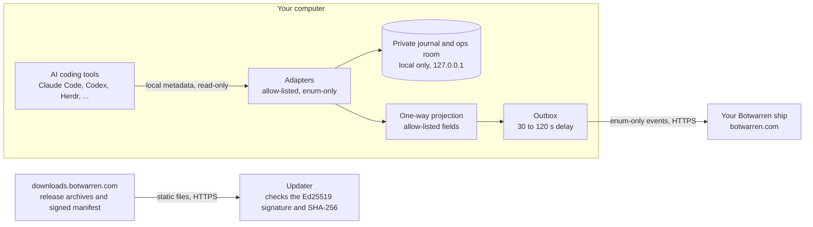

# Botwarren ship agent

[](https://github.com/turbokast/botwarren-ship/actions/workflows/ci.yml)
[](https://github.com/turbokast/botwarren-ship/actions/workflows/codeql.yml)
[](https://scorecard.dev/viewer/?uri=github.com/turbokast/botwarren-ship)
[](https://github.com/turbokast/botwarren-ship/releases)
[](LICENSE)
[](https://www.bestpractices.dev/projects/15500)

The ship agent runs on your own computer and turns what your AI coding agents are doing (Claude Code, Codex, Herdr, Ninox, OpenCode, Gemini CLI, ...) into a small, delayed, **metadata-only** status feed for your [Botwarren](https://botwarren.com) ship: who is working, who is waiting for you, how full a context window is, whether a build passed. It never reads or sends your prompts, code, command output, file contents or file paths.

**Optional, separate:** the agent can install exactly one other program, the Botwarren Companion (remote approvals, end-to-end encrypted), but only after you consent on your Botwarren account page, only that named component, and only from a manifest signed with the Botwarren component signing key (a separate key from the one that signs the agent's own updates, pinned separately: the agent accepts neither key for the other's job) and verified (signature, then file hash) before anything runs; it logs and tells you, and `botwarren companion remove|block` undoes or refuses it. Once it is installed, `botwarren companion pair` (also available as the command `botwarren-companion`, which the agent adds next to `botwarren`) pairs your phone; the other everyday commands (`devices`, `status`, `pause`, `resume`, `confirm`, `log`, `claude ...`) work the same way. The companion is its own open-source program with its own privacy statement and is not covered by the promise in the paragraph above, which describes this agent and stays true. See `src/component/` and [the trust page](https://botwarren.com/trust.html#companion).

This repository is the whole agent. The Botwarren website, hosted service and artwork are separate and not part of it. Everything the agent reads, keeps and sends is in this repository, so you can check it.

> Status: pre-release (0.7.x). Releases are built by a public workflow, attested with GitHub build provenance and described by an Ed25519-signed update manifest, which is what the installers and the automatic updater verify (see [Install](#install) and [Verify a release](#verify-a-release)). Windows files are not code-signed yet (see [Code signing policy](#code-signing-policy)).

## What it reads and what it never reads

| Reads (locally, read-only) | Never reads, never sends |
|---|---|
| File **names** and timestamps, and a few numeric or enum fields, of the session logs and local APIs of the AI tools you use. Each adapter declares exactly what it reads: `botwarren adapters explain <id>`. | Prompts, replies, code, diffs, command lines or their output, file contents |
| Which repository folders **you** configured, to match a session to a project you approved | Folder or file paths, repository names (unless you opt in to publishing real project names), environment values, tokens |

**Sends** (only to the Botwarren service you configured, delayed 30 to 120 seconds): enum-only events: a pseudonymous worker id, a state (`working`, `idle`, `waiting_for_human`, `left`), the tool family, a coarse context-fill bucket (`low`, `mid`, `high`, `full`), build and deploy states, a project you approved, and coarsened timestamps. There is no free-text field in the event format. There is no telemetry, analytics or crash reporting.

The full explanation, with the exact list of events and the checks that enforce it, is on the trust page: **<https://botwarren.com/trust.html>**. How it is enforced, in code you can read:

* **Adapters cannot leak by construction.** An adapter may only emit closed enums, bounded integers and id-like keys (`src/adapters/api.ts`). Text that exists on your machine (a project folder) stays in a private local journal and is never part of an event.
* **Read-only, allow-listed access.** Local HTTP is GET-only on `127.0.0.1` with an exact path allow-list; Herdr is only asked `agent.list` and `ping`; file reads are confined to declared folders and never follow symlinks.
* **A canary test guards every adapter.** `test/adapters/canary.test.ts` plants secret strings in prompts, tool output, titles, environment values and folder names and fails if one reaches any event, public projection or log line.
* **One-way boundary.** The public view is derived by an allow-listed projection (`projectPublic` in `src/vendor/core/projection.ts`). Nothing is "sanitised" afterwards, and the delay is not a privacy filter.
* **Local only otherwise.** The private journal and a loopback-only "ops room" (a page on `127.0.0.1`, protected by a token) stay on your machine. `botwarren pause` stops all publishing at once.

## How it fits together



More detail (adapter contract, packaging, the update trust chain): [docs/ARCHITECTURE.md](docs/ARCHITECTURE.md).

## Install

Releases are published on the [Releases page](https://github.com/turbokast/botwarren-ship/releases) and at `https://downloads.botwarren.com/`, with a `SHA256SUMS` file and GitHub build attestations.

The one-line installers are per user (no administrator rights). They download a pinned official Node.js runtime together with the agent, install under `~/.local/share/botwarren` or `%LOCALAPPDATA%\Botwarren`, add a `botwarren` command and register a per-user background service (systemd user service, launchd agent, or a per-user scheduled task). Read the script first if you like: both are in [`packaging/`](packaging/) (`install.sh --help` lists every option).

**Linux and macOS**

```sh
# signed manifest: the archive's hash must be in a release manifest signed with the release key compiled into the agent
curl -fsSL https://downloads.botwarren.com/install.sh | sh
```

**Windows 10 and 11 (PowerShell)**

```powershell
irm https://downloads.botwarren.com/install.ps1 | iex
```

**Connecting is part of the install.** On botwarren.com press *Get a ship*: the page shows one command made for your ship (it contains a single-use claim code that expires after 30 minutes and can only claim that ship; it is passed to the installer in the environment, so it does not show in the process list). Run it and the installer connects the computer, starts the agent, and the website switches to "Connected" by itself. Everything after that (which projects the ship shows, publish delay, tools, disconnect) is done on the website. If you run the plain installer instead, it shows a short code and opens your browser to approve it (on a machine with no desktop it prints the code and address once). Remove everything with `botwarren uninstall`.

The installers have two ways to decide that the download is the real one:

| | Signed manifest (default) | Checksum only (opt-in) |
|---|---|---|
| How | The archive's hash must be in a release manifest signed with the Ed25519 release key that is compiled into the agent; the installer runs `botwarren verify-release` before anything is installed or started. | The archive's hash must match `https://downloads.botwarren.com/<version>/SHA256SUMS`, fetched over HTTPS. |
| Protects against | A compromised download host or a man in the middle. | A corrupted or tampered download in transit (TLS) and mix-ups between files. **Not** a compromised download host: someone who controls it could change the archive and its checksum together. |
| Auto-update | On, silent, signed, reversible. | Disabled for that install until a signed manifest is available (the updater never runs unsigned code). |

```sh
# macOS and Linux: checksum-verified, a version you name (or the newest from latest.txt if you leave out --version)
curl -fsSL https://downloads.botwarren.com/install.sh | sh -s -- --checksum-only --version 0.5.0
```

```powershell
# Windows: checksum-verified (options are environment variables so they also work under iex)
$env:BOTWARREN_CHECKSUM_ONLY = '1'; $env:BOTWARREN_VERSION = '0.5.0'; irm https://downloads.botwarren.com/install.ps1 | iex
```

Checksum mode in detail: it resolves the version (`--version X.Y.Z`, or the one line in `https://downloads.botwarren.com/latest.txt`), downloads `<version>/SHA256SUMS`, requires the archive for your system to be listed there, downloads the archive, compares its SHA-256, lists it and refuses unsafe paths, and only then installs. `latest.txt` and `SHA256SUMS` are plain files with the same trust as the host, which is why the table is honest about what this mode does not cover. Without `--checksum-only` the installers use the signed path, and if a release has no signed manifest they stop and tell you so; they never quietly fall back.

**Trust trade-off, in one sentence:** the archive is verified over HTTPS against the published checksums or the signed manifest; you can also verify it against the GitHub Release and its build-provenance attestation, which does not depend on the download host (see [Verify a release](#verify-a-release)). To do that before installing, fetch the archive and `SHA256SUMS` yourself, verify them there, and use the manual route below.

### Manual install of a release archive

1. Download the archive for your system from the Releases page, plus `SHA256SUMS`.
2. Verify it ([next section](#verify-a-release)).
3. Unpack it into the install directory (the archive is exactly the installed layout) and start it:

```sh
mkdir -p ~/.local/share/botwarren
tar -xzf botwarren-<version>-linux-x64.tar.gz -C ~/.local/share/botwarren
export BOTWARREN_HOME=~/.local/share/botwarren
"$BOTWARREN_HOME/runtime/node/node" "$BOTWARREN_HOME/launcher/launcher.mjs" cli --version
```

(Windows: unpack the `.zip` to `%LOCALAPPDATA%\Botwarren`.) A background service is not registered by this route; the installers do that part.

Remove everything an installer put on your machine with `botwarren uninstall` (add `--keep-config` to keep your settings).

## Use

```
botwarren status                     is the agent running; what is it publishing
botwarren adapters [explain <id>]    which tools it can see, and exactly what each reads
botwarren run -- <build command>     report a build or test run as CI activity (the command text is never sent)
botwarren pause | resume             emergency stop and resume of publishing
botwarren ops                        where your private local ops room is
botwarren connect                    connect this computer to your ship (the website's command does this; or a code you approve on botwarren.com)
botwarren uninstall                  remove the agent from this computer (and tell botwarren.com)
botwarren pair                       older name for connect without a claim command (--repo adds a project folder by hand)
botwarren login                      sign in to botwarren.com as the owner of your ship
botwarren update [status]            updates (see below)
```

`botwarren connect` connects a computer to a ship with a single-use claim code (or a device code you approve): no long-lived secret is ever pasted. The ship secret is written to a separate file that only you can read and is never printed. Projects need no configuration: the agent notices git checkouts from the folders of your coding sessions and reports only an opaque key and a display name to your own website account (never a path); nothing is published until you switch a project on there. The configuration file (`config.json` in `~/.config/botwarren-ship/` or `%APPDATA%\Botwarren\`) has its schema in [`src/config.ts`](src/config.ts).

### Tools it can see

| Adapter | How | Notes |
|---|---|---|
| Claude Code | session log metadata | sub-agents, tool errors, steps, context fill. Verified against a live install |
| Codex | rollout file headers | pairs with a Claude session of the same project. Verified against a live install |
| Herdr | local socket, `agent.list` only | named sessions supported; Windows unverified |
| Ninox | `127.0.0.1` read-only API | macOS and Linux; merged with the Claude session it runs. Unverified against a live install |
| OpenCode | its local server (2.x and 1.x; 2.x needs `OPENCODE_SERVER_PASSWORD` in the agent's environment) | 2.x routes and login behaviour checked live on an empty server, session rows from its API document; 1.x from documentation |
| Gemini CLI | file names only | unverified against a live install |

Configure in `config.json`: `"adapters": { "ninox": { "enabled": true, "port": 8081 } }`. To add a tool, see [docs/ADAPTERS.md](docs/ADAPTERS.md) and [CONTRIBUTING.md](CONTRIBUTING.md): every adapter needs a canary test scenario.

## Updates

Automatic updates are silent, signed and reversible. A release is described by a manifest signed with an Ed25519 key whose public half is compiled into the agent; the production key is a non-exportable Google Cloud KMS key that only the release workflow can use, and any two of three offline recovery keys can rotate or revoke it. The agent refuses anything not listed in the manifest with a matching SHA-256, refuses older manifests, and runs a new version on trial and rolls back if it is unhealthy. An install made with `--checksum-only` is not updated automatically (re-run the installer to move to a newer version); it starts receiving signed updates once you reinstall in signed mode. The development public key that is also compiled in is refused unless you set `BOTWARREN_UPDATE_ALLOW_DEV_KEY=1`.

An update check is two static file downloads from `https://downloads.botwarren.com/` and sends only the HTTP request itself (with a `botwarren-agent/<version>` user agent). There is no telemetry. Turn it off: `BOTWARREN_DISABLE_AUTOUPDATE=1` (manual `botwarren update` still works), `BOTWARREN_DISABLE_UPDATES=1` (no update traffic at all), or `"updates": { "enabled": false }` in `config.json`. Installs made by a package manager never self-update.

## Verify a release

Every release archive is built by [`release.yml`](.github/workflows/release.yml) from a tagged commit, in a protected environment that needs a reviewer's approval, and is attested with GitHub artifact attestations (Sigstore build provenance). Check what you downloaded:

```sh
sha256sum --check --ignore-missing SHA256SUMS          # macOS: shasum -a 256 -c SHA256SUMS
gh attestation verify botwarren-<version>-linux-x64.tar.gz --repo turbokast/botwarren-ship
```

```powershell
# Windows: compare with the line for your file in SHA256SUMS
Get-FileHash .\botwarren-<version>-win-x64.zip -Algorithm SHA256
gh attestation verify .\botwarren-<version>-win-x64.zip --repo turbokast/botwarren-ship
```

The checksum list can come from `https://downloads.botwarren.com/<version>/SHA256SUMS` or from the GitHub Release; compare the two (they must be identical). Only the attestation is independent of the download host, so for a stricter check pin what it must say:

```sh
gh attestation verify botwarren-<version>-linux-x64.tar.gz --repo turbokast/botwarren-ship \
  --signer-workflow turbokast/botwarren-ship/.github/workflows/release.yml --source-ref refs/tags/v<version>
# offline, from the attestation bundle attached to the Release (the file attestations-<version>.sigstore.jsonl):
gh attestation verify botwarren-<version>-linux-x64.tar.gz --repo turbokast/botwarren-ship --bundle attestations-<version>.sigstore.jsonl
```

(Needs the GitHub CLI; the first form asks GitHub's API for the attestations of the file's SHA-256, so run `gh auth login` first.) You can also check a downloaded `manifest.json` and `manifest.json.sig` against the keys compiled into the agent with `botwarren verify-release --manifest manifest.json --sig manifest.json.sig`.

The attestation proves the file was produced by that workflow in this repository at that commit. Reproducible builds (fixed timestamps, sorted entries) let you rebuild and compare hashes: see [Build from source](#build-from-source) and [docs/RELEASING.md](docs/RELEASING.md).

## Build from source

Requires Node.js 22.18 or newer (CI and releases use 24; `.nvmrc`) and [pnpm](https://pnpm.io) 11.

```sh
pnpm install
pnpm lint
pnpm typecheck
pnpm test
node scripts/build-release.mjs --no-manifest                  # full archives (add --offline to use only the cached, hash-pinned Node runtimes)
```

The release build downloads the pinned Node.js runtime once (checked against both nodejs.org's `SHASUMS256.txt` and the hash committed in `packaging/node-pins.json`) and caches it in `.cache/node`. Tests need no network.

`src/vendor/core/` holds the small, audited public contract (the event schema, the local reducer, and the one-way projection into the public schema), copied from the Botwarren core package at export time. It is part of this project and licensed like it.

## Documentation

| | |
|---|---|
| [docs/ARCHITECTURE.md](docs/ARCHITECTURE.md) | data flow, the adapter contract, packaging, the signed update design |
| [docs/ADAPTERS.md](docs/ADAPTERS.md) | how to write an adapter, and the canary rule |
| [docs/RELEASING.md](docs/RELEASING.md) | how a release is made and verified; key custody and recovery |
| [docs/REPO_SETTINGS.md](docs/REPO_SETTINGS.md) | the repository settings, the branch ruleset and what each protects |
| [docs/OPENSSF_BEST_PRACTICES.md](docs/OPENSSF_BEST_PRACTICES.md) | the OpenSSF Best Practices questionnaire, answered with evidence |
| [CHANGELOG.md](CHANGELOG.md) | what changed in each release |
| [GOVERNANCE.md](GOVERNANCE.md), [MAINTAINERS.md](MAINTAINERS.md), [SUPPORT.md](SUPPORT.md) | who decides, who maintains, where to ask |

## Code signing policy

Free code signing provided by [SignPath.io](https://signpath.io), certificate by [SignPath Foundation](https://signpath.org). (Windows release files will be signed with it once the project is accepted by the SignPath Foundation; until then Windows files are unsigned and the release notes say so.)

**Team roles.** All three roles for this project are currently held by one person:

| Role | Member |
|---|---|
| Committers and reviewers | Liam Humphreys (TurboKast Ltd) |
| Approvers (approve every signing request) | Liam Humphreys |

Every signing request is made by the release workflow from a tagged commit of this repository, in a protected GitHub environment, and has to be approved by an approver before a file is signed. Only artifacts built by that workflow from this repository's source are signed; no binaries of other projects are signed. The bundled Node.js runtime is the unmodified official build, already signed by its publisher.

**Privacy.** This program does not transfer information to other networked systems except as follows, and only because you installed and configured it to: (1) it sends the metadata-only, delayed status feed described above to the Botwarren service of the ship you configured (by default `botwarren.com`), and `botwarren login` contacts that same service; (2) it checks for updates by downloading static files from `downloads.botwarren.com`, which receives the request itself and nothing else; (3) only if you consented on your Botwarren account page to the **optional, separate Botwarren Companion** (remote approvals), it downloads that one signed component from the same host, tells your ship's service the companion's public key and whether the install worked, and can remove it again; the companion itself is not part of this program and is described on its own pages. This program does not send source code, prompts, file contents or paths, and it contains no analytics or crash reporting. These transfers can be switched off (`botwarren pause`, or do not configure a ship; `BOTWARREN_DISABLE_UPDATES=1`; `botwarren companion block` or `BOTWARREN_DISABLE_COMPONENTS=1` for the optional component). Details: <https://botwarren.com/trust.html>.

## Security

Report vulnerabilities privately: use **Security, Report a vulnerability** on GitHub, or email **support@turbokast.com** (see [SECURITY.md](SECURITY.md)). Please do not open public issues for them. The repository is scanned with CodeQL, secret scanning with push protection and the OpenSSF Scorecard; [SECURITY.md](SECURITY.md) lists what is checked on every change.

## Contributing

Contributions are welcome, and the bar is clear: the agent reads and sends metadata only. Good first steps: pick an [issue labelled `good first issue`](https://github.com/turbokast/botwarren-ship/labels/good%20first%20issue), request or write an [adapter for another tool](docs/ADAPTERS.md), or improve the docs. Contributions are accepted under the Apache-2.0 licence with a DCO sign-off (`git commit -s`): see [CONTRIBUTING.md](CONTRIBUTING.md) and the [Code of Conduct](CODE_OF_CONDUCT.md). Questions go to [Discussions](https://github.com/turbokast/botwarren-ship/discussions) ([SUPPORT.md](SUPPORT.md)).

## Licence

Apache License 2.0, Copyright 2026 TurboKast Ltd. See [LICENSE](LICENSE) and [NOTICE](NOTICE). Botwarren and TurboKast are names of TurboKast Ltd; the licence does not grant rights to use them beyond describing the origin of the software.
